# Election Logistics in Maharashtra

IE301 Operations Analysis · IEOR, IIT Bombay · Group 4

Pari Soni (24b4505) · Shivam Soni (24b4525) · Shreyaan Sharma (24b4529) · Asmaniwala Devanshu (26x0053) · S Ganesh (26x0052)
Mentor: Prof. Ketan Savla

[Final presentation (PDF)](docs/presentations/04_final_presentation.pdf) · [Technical report](output/pdf/election_logistics_technical_report.pdf) · [All presentations](docs/presentations/)

An operations-research pipeline for Indian Assembly elections, applied to four Maharashtra districts (Sangli, Satara, Nashik, Pune; 52 seats, 1.9 crore electors). It redraws constituencies with ReCom districting, places polling stations with a mixed-integer program, routes EVMs with vehicle routing, and simulates polling-day queues. Results are compared with the 2008 seats and validated against the 2024 election.

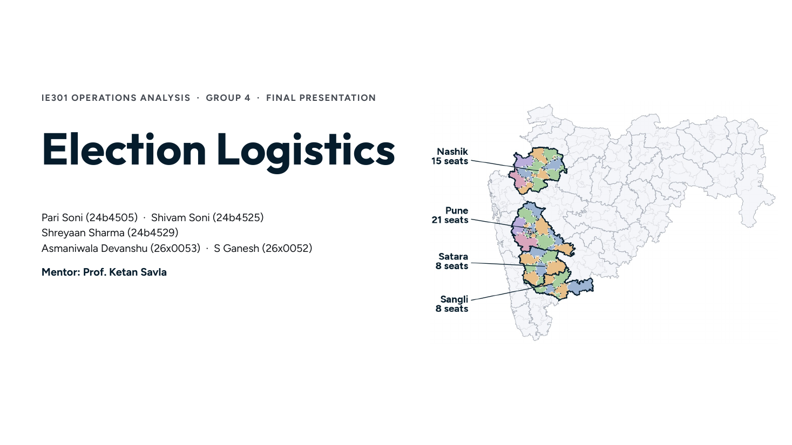
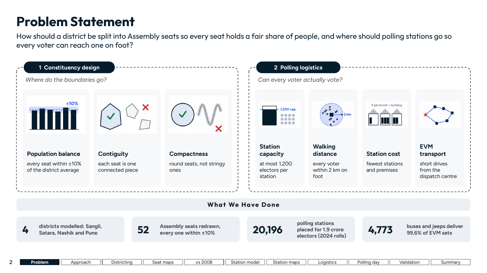
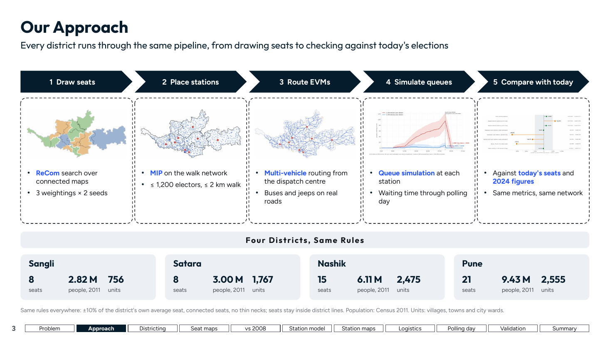

## Districting

Seats are drawn on the village border graph with ReCom and simulated annealing. Every seat is connected and within ±10% of the district's average. The score weighs population, distance, taluka splits and compactness. All 52 seats fall inside ±10% in every map; today 26 of 52 are outside.

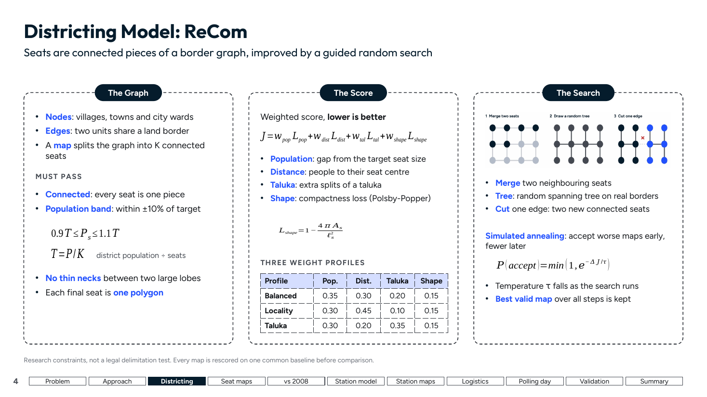
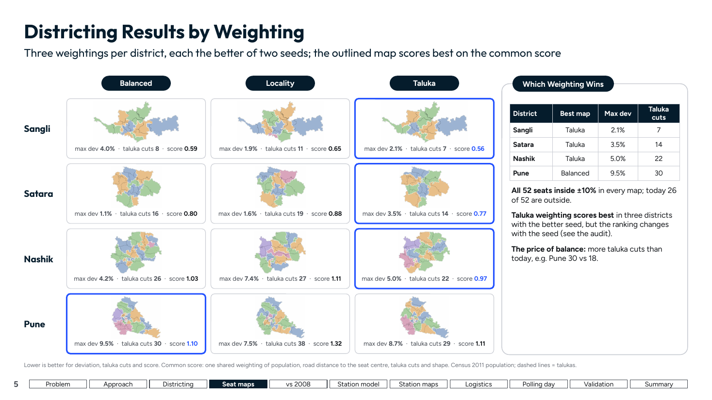
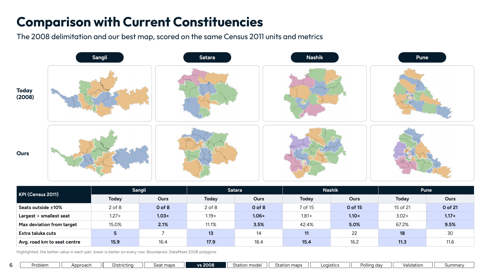

## Polling stations

Census 2011 counts are scaled to the 2024 rolls and spread over WorldPop 100 m settlements; walks are measured on OpenStreetMap paths. A Gurobi MIP per seat picks premises, stations per premises and one EVM dispatch centre. It opens 20,196 stations at 14,532 premises, with a 0.54 km average walk and 99.6% of electors within 2 km.

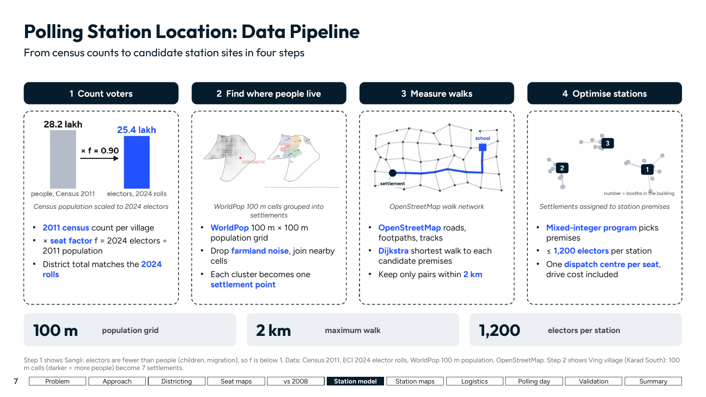
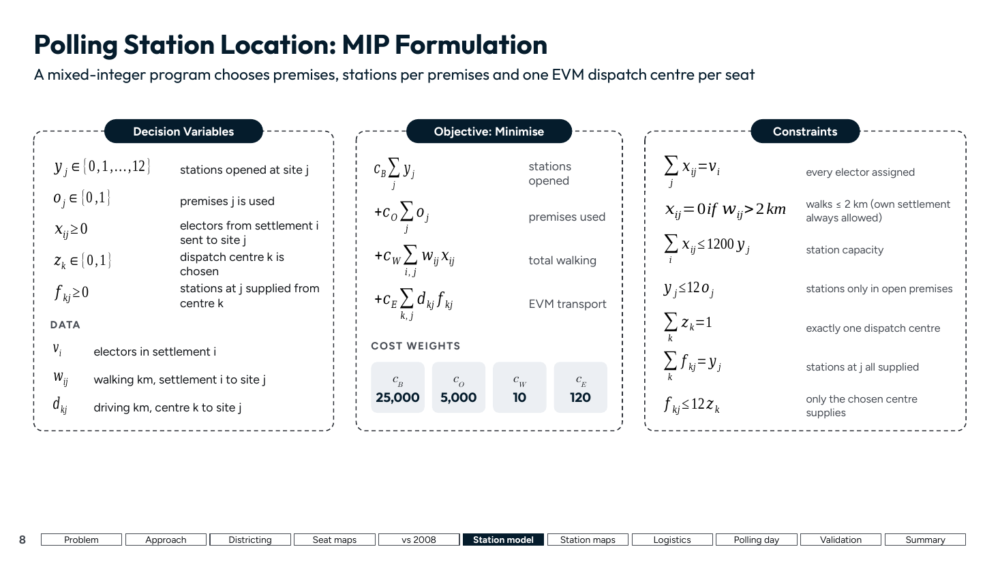
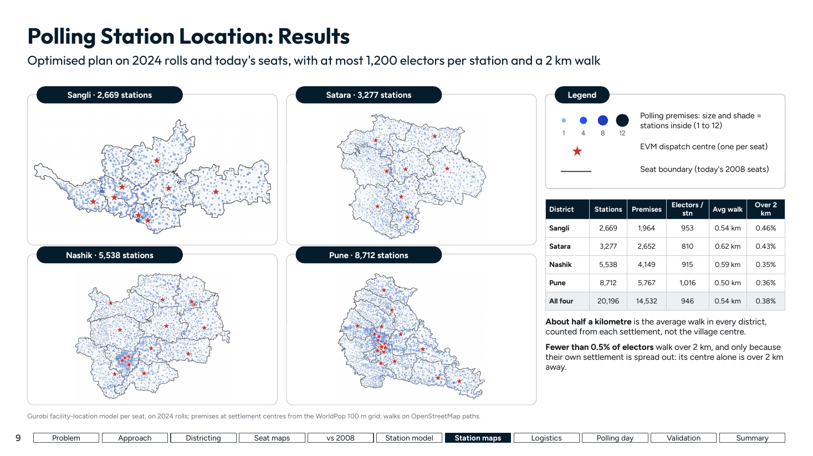

## Logistics

EVM sets and polling teams travel from each seat's dispatch centre by bus (6 sets) or jeep (1 set), solved as vehicle routing with time windows in OR-Tools. 4,773 vehicles deliver 99.6% of sets by 18:00. Shared routes cut vehicle-km by 77%, and choosing the dispatch centre saves another 14%. The plan costs ₹35–45 per elector.

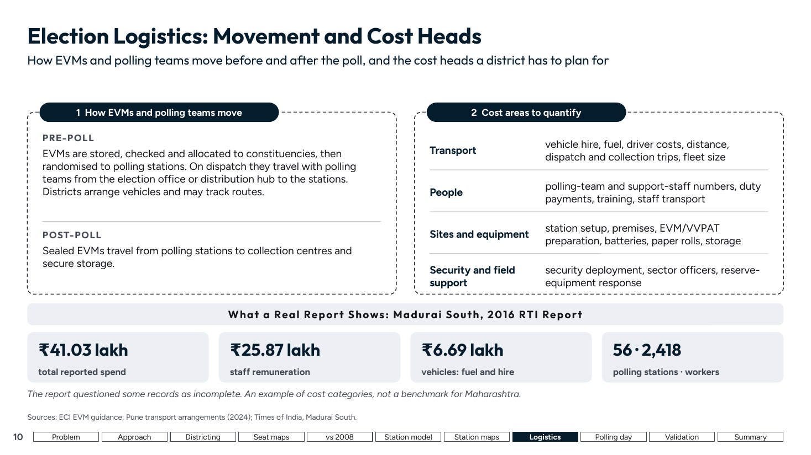
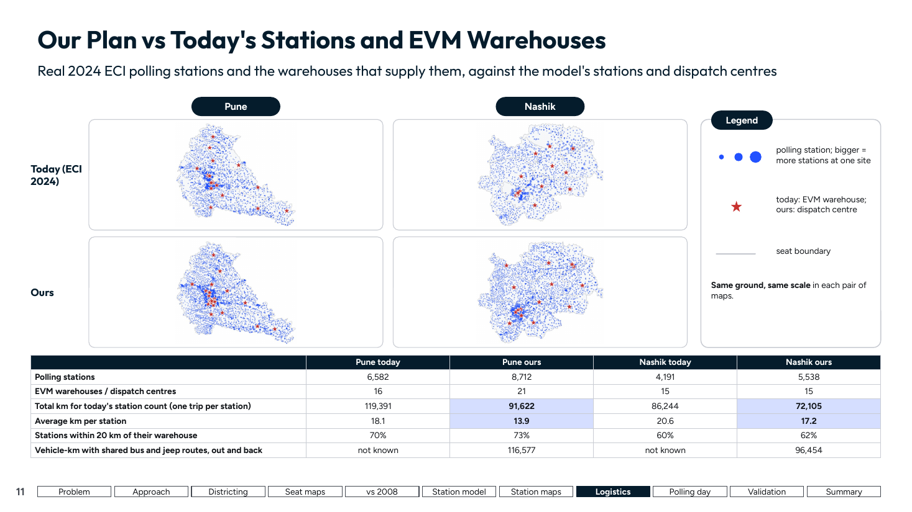
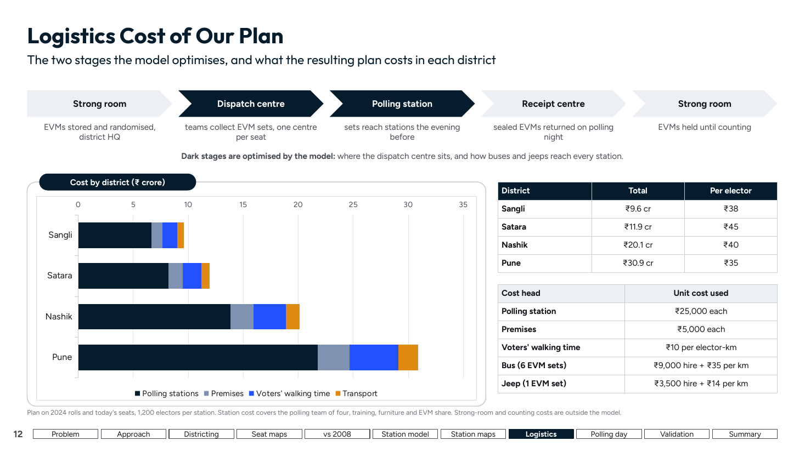
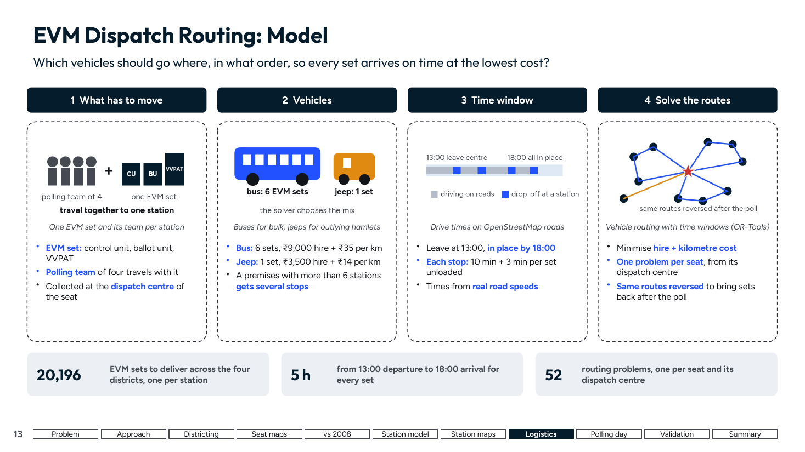
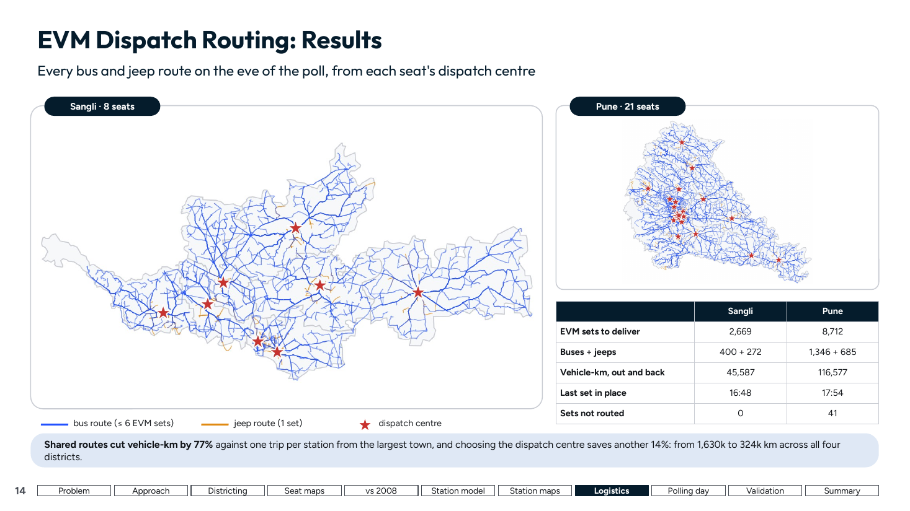

## Polling day

A queue simulation runs each station for 30 days. Arrivals follow Maharashtra's 2024 hourly turnout, with 40 s per voter and EVM failures. Cutting the cap from 1,500 to 1,200 electors per station drops the average wait from 7.7–12.8 min to 2.2–4.6 min, for about ₹4 more per elector.

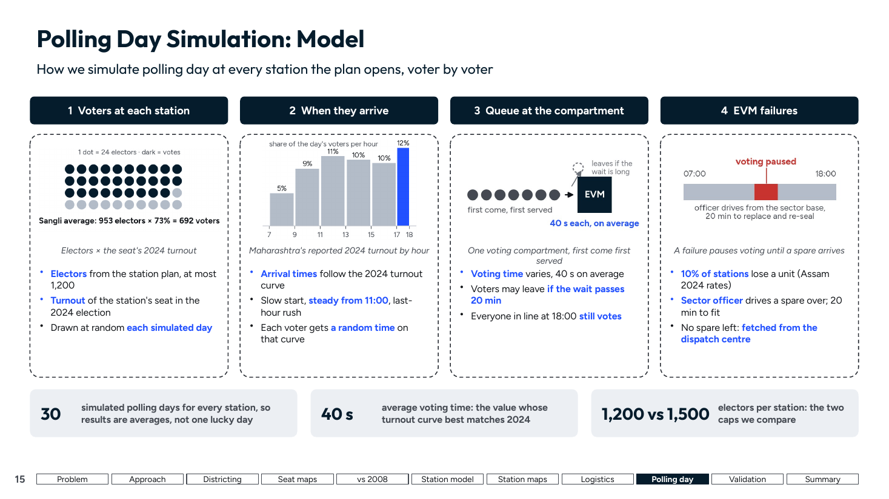
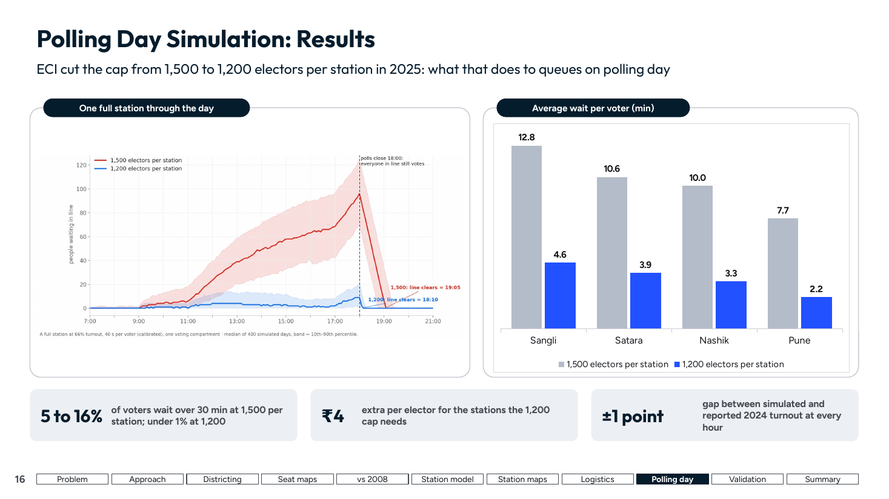

## Validation

The model is within 3% of Pune's real 2024 polling stations (8,712 vs 8,462). Simulated hourly turnout is within ±1 point of the reported curve. The largest misses are Nashik's rural station count (+12.5%) and Pune's city bus fleet (−30%).

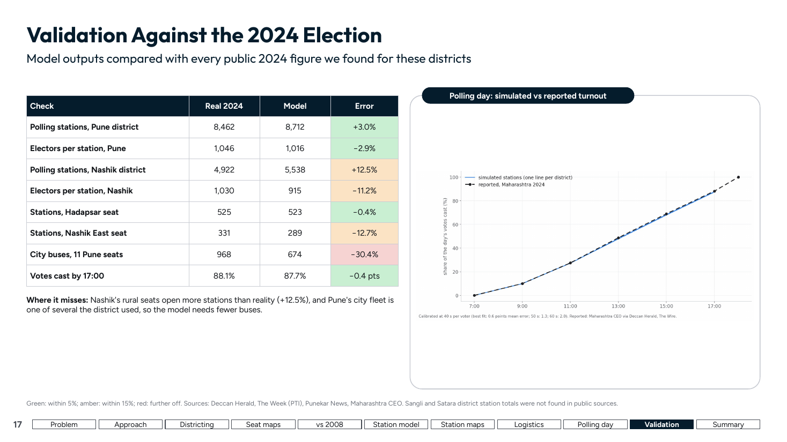

## Summary

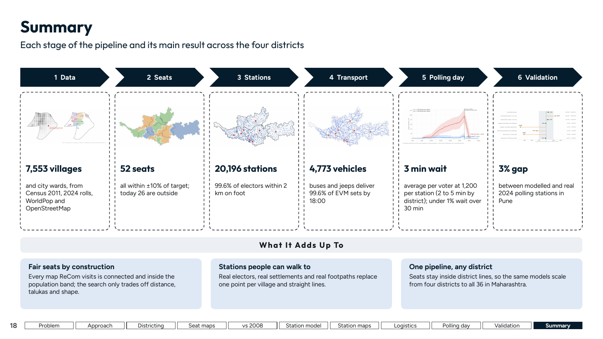

---

## Code

| Layer | Code |
|---|---|
| Constituencies (ReCom districting) | `code/sangli_recom.py`, `code/prepare_district_inputs.py`, `code/official_district_map.py` |
| Audit of the official 2008 map on real rolls | `code/audit_official_2008.py`, `code/fetch_ac_electors.py` |
| Walking and driving networks (OSM) | `code/logistics/network.py` |
| Demand: 2024 electors, hamlets, walk inside villages | `code/logistics/demand.py` |
| Joint dispatch centre + polling-station location (Gurobi) | `code/logistics/location.py` |
| Dispatch routing (OR-Tools CVRPTW) and sectors | `code/logistics/routing.py` |
| Polling-day queue and EVM-failure simulation | `code/logistics/simulate.py` |
| SC/ST reservation and Lok Sabha seats | `code/logistics/representation.py`, `code/group_lok_sabha.py` |
| Scenario sweep | `code/logistics/scenarios.py` |

The design and every model's formulation are in [docs/BLUEPRINT.md](docs/BLUEPRINT.md). Raw inputs (OSM extract, WorldPop, SHRUG, DataMeet) are not in the repository; the scripts name their sources. SHRUG-derived data is CC BY-NC-SA 4.0.

```bash
python -m venv .venv && .venv/bin/pip install numpy pandas scipy pulp highspy ortools osmium rasterio shapely networkx geopandas pyproj scikit-learn numba gurobipy
cd code
../.venv/bin/python -m logistics.network --district sangli
../.venv/bin/python -m logistics.demand --district sangli
../.venv/bin/python -m logistics.scenarios --districts sangli --stage all
```
