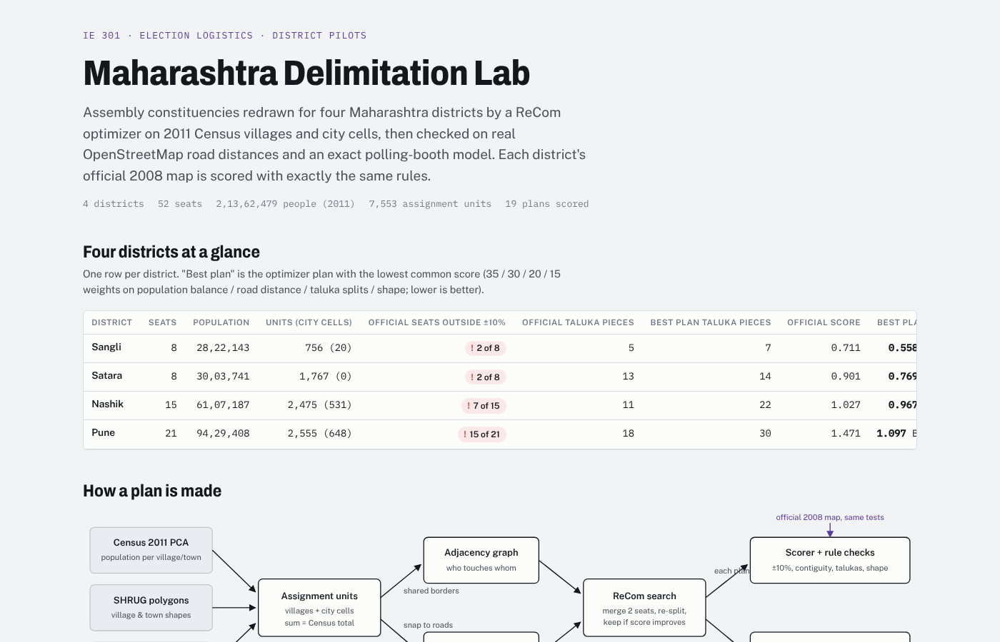

<div align="center">

# Election Logistics in Maharashtra

### Redrawing Assembly seats, placing polling stations, routing EVMs and simulating polling day: one operations-research pipeline, checked against the 2024 election

**IE301 Operations Analysis · IEOR, IIT Bombay · Group 4**

Pari Soni (24b4505) · Shivam Soni (24b4525) · Shreyaan Sharma (24b4529) · Asmaniwala Devanshu (26x0053) · S Ganesh (26x0052)
Mentor: **Prof. Ketan Savla**


[**Final presentation**](docs/presentations/04_final_presentation.pdf) ·
[**Technical report (59 pp.)**](output/pdf/election_logistics_technical_report.pdf) ·
[**All slides**](docs/presentations/) ·
[**Model blueprint**](docs/BLUEPRINT.md) ·
[**Interactive showcase**](#interactive-showcase)

</div>

---


## The question

> **How should a district be split into Assembly seats so every seat holds a fair share of people, and where should polling stations go so every voter can reach one on foot?**

Maharashtra still votes on seats drawn in the 2008 delimitation. Since then, people have moved to the cities and the seats have drifted apart. In 2024, **101 of 288 seats were more than 10% off** their district's average, and the largest (Chinchwad, 663,788 electors) is **3.2×** the smallest (Wadala). Running the election means about 1 lakh polling stations, 5 lakh staff and lakhs of EVM units moved out and back within two days.

We built a chain of models that answers both halves of the question for **four districts (Sangli, Satara, Nashik and Pune)**, and checked every model output we could against public 2024 figures.


## Headline results

| | Result |
|---|---|
| **52 seats redrawn** | All 52 within ±10% of their district's target in every map; **today 26 of 52 are outside** |
| **20,196 polling stations** | Placed at 14,532 premises for **1.9 crore electors** (2024 rolls); **99.6% of electors within 2 km** on foot, 0.54 km average walk |
| **4,773 buses and jeeps** | Deliver 99.6% of EVM sets by 18:00; shared routes cut vehicle-km by **77%**, and a well-placed dispatch centre saves another 14% (1,630k → 324k km) |
| **3 min average wait** | At 1,200 electors per station (2 to 5 min by district); under 1% wait over 30 min, against **5–16% at the old 1,500 cap** |
| **₹35–45 per elector** | Full logistics cost of the plan: Sangli ₹9.6 cr, Satara ₹11.9 cr, Nashik ₹20.1 cr, Pune ₹30.9 cr |
| **3% gap** | Between modelled (8,712) and real (8,462) 2024 polling stations in Pune; simulated hourly turnout within ±1 point of the reported curve |

## How it works

Every district runs through the same pipeline. Each model hands its output to the next, so one rule change (a new map, a new station cap, a new walk limit) flows through to cost, access and waiting time.


| Stage | Model | What it decides |
|---|---|---|
| **0. Demand and networks** | Census 2011 × seat factor to match 2024 rolls; WorldPop 100 m cells clustered into settlements; OpenStreetMap walk and drive graphs | Who votes where, and how far each walk and drive is |
| **1. Draw seats** | **ReCom** (merge two seats → random spanning tree → cut one edge) with simulated annealing on the village border graph | Seats that are connected, within ±10%, with no thin necks; score trades off population, distance, taluka splits and shape |
| **2. Place stations** | **Mixed-integer program** (Gurobi), one per seat | Which premises open, how many stations each (≤ 12), which settlement votes where (≤ 1,200 electors, ≤ 2 km), and the seat's EVM dispatch centre |
| **3. Route EVMs** | **Vehicle routing with time windows** (OR-Tools), one problem per seat | Bus (6 sets) and jeep (1 set) routes: leave at 13:00, every set in place by 18:00, routes reversed after the poll |
| **4. Simulate polling day** | **Discrete-event / Monte Carlo** queue simulation, 30 days per station | Waits, the 18:00 backlog and EVM failures, with arrivals from Maharashtra's 2024 hourly turnout |
| **5. Compare with today** | Same metrics on the official 2008 seats, ECI 2024 stations and EVM warehouses | Where the model matches reality and where it misses |

<details>
<summary><b>The districting score</b></summary>

Lower is better: J = w<sub>pop</sub>L<sub>pop</sub> + w<sub>dist</sub>L<sub>dist</sub> + w<sub>tal</sub>L<sub>tal</sub> + w<sub>shape</sub>L<sub>shape</sub>, with the shape loss 1 − 4πA/P² (Polsby–Popper). Hard rules sit outside J: every seat connected, 0.9T ≤ P<sub>s</sub> ≤ 1.1T with T = district population ÷ seats, and no thin necks. Each district is run with three weightings (Balanced, Locality, Taluka) × 2 seeds, and every map is rescored on one common baseline before comparison.


</details>

<details>
<summary><b>The polling-station MIP</b></summary>

Minimise c<sub>B</sub>Σy<sub>j</sub> + c<sub>O</sub>Σo<sub>j</sub> + c<sub>W</sub>Σw<sub>ij</sub>x<sub>ij</sub> + c<sub>E</sub>Σd<sub>kj</sub>f<sub>kj</sub>: stations, premises, voters' walking and EVM transport, with weights 25,000 / 5,000 / 10 / 120. It is subject to:
- every elector is assigned
- no walk is over 2 km (a voter's own settlement is always allowed)
- each station holds at most 1,200 electors
- each open premises has at most 12 stations
- each seat has exactly one dispatch centre, and every station is supplied from it


</details>

## Results

### 1. Fairer seats, at a price in taluka splits

All four districts get maps with **every seat inside ±10%**. The cost is administrative coherence: our maps cut more talukas than the 2008 map does (e.g. Pune 30 vs 18).

| KPI (Census 2011) | Sangli today → ours | Satara | Nashik | Pune |
|---|---|---|---|---|
| Seats outside ±10% | 2 of 8 → **0** | 2 of 8 → **0** | 7 of 15 → **0** | 15 of 21 → **0** |
| Largest ÷ smallest seat | 1.27× → **1.03×** | 1.19× → **1.06×** | 1.81× → **1.10×** | 3.02× → **1.17×** |
| Max deviation from target | 15.0% → **2.1%** | 11.1% → **3.5%** | 42.4% → **5.0%** | 67.2% → **9.5%** |
| Extra taluka cuts | **5** → 7 | **13** → 14 | **11** → 22 | **18** → 30 |
| Avg. road km to seat centre | **15.9** → 16.4 | **17.9** → 18.4 | **15.4** → 16.2 | **11.3** → 11.6 |


### 2. Polling stations every voter can walk to

The model works from real settlements and real footpaths instead of one point per village and straight lines. The average walk is about half a kilometre in every district. Fewer than 0.5% of electors walk over 2 km, and only because their own settlement is spread out.

| District | Stations | Premises | Electors / station | Avg walk | Over 2 km |
|---|---:|---:|---:|---:|---:|
| Sangli | 2,669 | 1,964 | 953 | 0.54 km | 0.46% |
| Satara | 3,277 | 2,652 | 810 | 0.62 km | 0.43% |
| Nashik | 5,538 | 4,149 | 915 | 0.59 km | 0.35% |
| Pune | 8,712 | 5,767 | 1,016 | 0.50 km | 0.36% |
| **All four** | **20,196** | **14,532** | **946** | **0.54 km** | **0.38%** |

<table>
<tr>
<td width="50%"></td>
<td width="50%"></td>
</tr>
<tr>
<td align="center"><sub>Optimised stations and dispatch centres</sub></td>
<td align="center"><sub>Every bus and jeep route on the eve of the poll</sub></td>
</tr>
</table>

### 3. EVM transport

Against today's ECI stations and EVM warehouses, our dispatch centres cut the average drive per station from 18.1 to **13.9 km in Pune** and from 20.6 to **17.2 km in Nashik**. The 18:00 deadline turns out to be slack: routes take about an hour, so bus seats, not the clock, set the fleet.

### 4. Polling day: what the 1,200 cap buys

In 2025 the ECI cut the cap from 1,500 to 1,200 electors per station. In our simulation, a full 1,500-elector station builds a queue of about 95 people by 18:00 that clears around 19:05. At 1,200 the line stays under 10 and clears by about 18:10. The average wait falls from 7.7–12.8 min to **2.2–4.6 min**, for about **₹4 extra per elector**.


### 5. Validation against the 2024 election

| Check | Real 2024 | Model | Error |
|---|---:|---:|---:|
| Polling stations, Pune district | 8,462 | 8,712 | +3.0% |
| Electors per station, Pune | 1,046 | 1,016 | −2.9% |
| Polling stations, Nashik district | 4,922 | 5,538 | +12.5% |
| Stations, Hadapsar seat | 525 | 523 | −0.4% |
| Stations, Nashik East seat | 331 | 289 | −12.7% |
| City buses, 11 Pune seats | 968 | 674 | −30.4% |
| Votes cast by 17:00 | 88.1% | 87.7% | −0.4 pts |

**Where it misses:** Nashik's rural seats open more stations than reality (+12.5%). Pune's city bus fleet was one of several fleets the district used, so the model needs fewer buses.

## How the project evolved

The project went through four presentations, from framing the problem to the final pipeline. All four decks are in [`docs/presentations/`](docs/presentations/).

| # | Deck | What we did |
|---|---|---|
| 1 | [Problem framing](docs/presentations/01_problem_framing.pdf) | Constituency design (population, geography, demographics) plus operational constraints (booth capacity, budget, travel time); India's delimitation history; the gerrymandering question |
| 2 | [Methods survey](docs/presentations/02_methods_survey.pdf) | Evaluation factors (balance, compactness, accessibility); the official delimitation heuristic; a genetic algorithm, quadtree splitting and graph partitioning (Kernighan–Lin, multilevel) |
| 3 | [Sangli pilot](docs/presentations/03_sangli_pilot.pdf) | Real data for one district (756 units, 1,988 border edges). The GA stalled and produced stringy seats, **so districting moved to ReCom** and booths became a second stage |
| 4 | [**Final**](docs/presentations/04_final_presentation.pdf) | Four districts, settlement-level demand, joint station + dispatch-centre MIP, EVM routing, polling-day simulation and validation against 2024 |

The [technical report](output/pdf/election_logistics_technical_report.pdf) reconstructs this evolution in detail, separating superseded experiments from the current models. It also lists the limits honestly.

## Interactive showcase

[`showcase/index.html`](showcase/index.html) is the **Maharashtra Delimitation Lab**, a single self-contained page. It lets you switch districts, explore every map and compare it with the 2008 seats. Download it and open it in a browser, or serve the folder:

```bash
python -m http.server 8765 --directory showcase
```

[](showcase/index.html)

## Repository map

```
election-logistics-maharashtra/
├── README.md
├── docs/
│   ├── presentations/            all four decks (PDF) + final slides as images
│   ├── technical_report/         LaTeX source, builder and frozen evidence of the 59-page report
│   └── BLUEPRINT.md              system design and every model's formulation
├── output/pdf/                   compiled technical report
├── code/
│   ├── logistics/                the operational chain (network → demand → location → routing → simulation)
│   ├── district_config/          one JSON per district
│   ├── data/                     seat lists, 2011 → current crosswalk, electors, validation benchmarks
│   ├── pilots/, sangli_road/     districting runs per district (3 weightings × 2 seeds)
│   ├── official_2008/            the 2008 seats on the same units
│   └── logistics_runs/           scenario results and summary tables
├── figures/                      presentation figures (see figures/README.md) and result maps
├── showcase/                     interactive Delimitation Lab
└── IE301_Election_logistics.ipynb   exploratory notebook
```

| Layer | Code |
|---|---|
| Constituencies (ReCom districting) | `code/sangli_recom.py`, `code/prepare_district_inputs.py`, `code/official_district_map.py` |
| Audit of the official 2008 map on real rolls | `code/audit_official_2008.py`, `code/fetch_ac_electors.py` |
| Walking and driving networks (OSM) | `code/logistics/network.py` |
| Demand: 2024 electors, hamlets, walk inside villages | `code/logistics/demand.py` |
| Joint dispatch centre + polling-station location (Gurobi) | `code/logistics/location.py` |
| Dispatch routing (OR-Tools CVRPTW) and sectors | `code/logistics/routing.py` |
| Polling-day queue and EVM-failure simulation | `code/logistics/simulate.py` |
| SC/ST reservation and Lok Sabha seats | `code/logistics/representation.py`, `code/group_lok_sabha.py` |
| Scenario sweep (cap, walk limit, depot rule, demand year, best map) | `code/logistics/scenarios.py` |
| Validation against 2024 | `code/logistics/validate.py` |

## Run it

```bash
python -m venv .venv && .venv/bin/pip install numpy pandas scipy pulp highspy ortools osmium rasterio shapely networkx geopandas pyproj scikit-learn numba gurobipy
cd code
../.venv/bin/python -m logistics.network --district sangli
../.venv/bin/python -m logistics.demand --district sangli
../.venv/bin/python -m logistics.scenarios --districts sangli --stage all
```

- **Gurobi:** the location model needs a licence (free for academics). Point `GRB_LICENSE_FILE` at your `gurobi.lic`.
- **Raw inputs** (OSM extract, WorldPop, SHRUG, DataMeet) are multi-GB and not in the repository. Each script names its source.
- `--stage` takes `location`, `routing`, `simulation`, `collect` or `all`; `--scenarios` picks from `base`, `cap1500`, `walk3`, `depot_hq`, `depot_median`, `village_rule`, `no_intra`, `census2011`, `ac_calibrated`, `best_map`.

## Limitations

- These are research constraints, not a legal delimitation test. Population balance uses Census 2011, the last census available.
- Station and transport costs, EVM failure rates (taken from Assam 2024) and voting time (calibrated to 40 s) are assumed or transferred, not measured locally.
- Routing may drop hard-to-reach stops: 41 sets in Pune are not routed in the base run. Some location solves stop at their time limit.
- Seats stay inside district lines, so the same pipeline scales to all 36 districts, but only four were run.

## Data and acknowledgements

- **Census 2011** Primary Census Abstract and village/town polygons via **SHRUG** (CC BY-NC-SA 4.0; derived data keeps that licence)
- **ECI** 2009–2024 electors per seat (via Wikipedia constituency pages) and 2024 polling stations; Maharashtra CEO hourly turnout
- **WorldPop** 100 m population grid · **OpenStreetMap** roads, footpaths and tracks · **DataMeet** 2008 Assembly polygons
- Validation figures: Deccan Herald, The Week (PTI), Punekar News, The Wire
- Thanks to **Prof. Ketan Savla** for mentoring the project.
