# Presentations

Four presentations, given over the course of IE301 Operations Analysis (IEOR, IIT Bombay). Together they trace how the project moved from framing the question to the final pipeline.

| # | Deck | Pages | What it covers |
|---|---|---:|---|
| 1 | [Problem framing](01_problem_framing.pdf) | 10 | Constituency design vs operational constraints, India's delimitation history, gerrymandering |
| 2 | [Methods survey](02_methods_survey.pdf) | 8 | Evaluation factors; official heuristic, genetic algorithm, quadtree, graph partitioning |
| 3 | [Sangli pilot](03_sangli_pilot.pdf) | 10 | One district on real data; GA tried and replaced by ReCom; booths as a second stage |
| 4 | [**Final presentation**](04_final_presentation.pdf) | 18 | Four districts: seats, stations, EVM routing, polling-day simulation, validation |

## Final presentation, slide by slide

The final deck is reproduced below as images so it can be read on GitHub without downloading the PDF.

1. [Title](#1-title)
2. [Problem statement](#2-problem-statement)
3. [Our approach](#3-our-approach)
4. [Districting model: ReCom](#4-districting-model-recom)
5. [Districting results by weighting](#5-districting-results-by-weighting)
6. [Comparison with current constituencies](#6-comparison-with-current-constituencies)
7. [Polling station location: data pipeline](#7-polling-station-location-data-pipeline)
8. [Polling station location: MIP formulation](#8-polling-station-location-mip-formulation)
9. [Polling station location: results](#9-polling-station-location-results)
10. [Election logistics: movement and cost heads](#10-election-logistics-movement-and-cost-heads)
11. [Our plan vs today's stations and EVM warehouses](#11-our-plan-vs-todays-stations-and-evm-warehouses)
12. [Logistics cost of our plan](#12-logistics-cost-of-our-plan)
13. [EVM dispatch routing: model](#13-evm-dispatch-routing-model)
14. [EVM dispatch routing: results](#14-evm-dispatch-routing-results)
15. [Polling day simulation: model](#15-polling-day-simulation-model)
16. [Polling day simulation: results](#16-polling-day-simulation-results)
17. [Validation against the 2024 election](#17-validation-against-the-2024-election)
18. [Summary](#18-summary)

### 1. Title
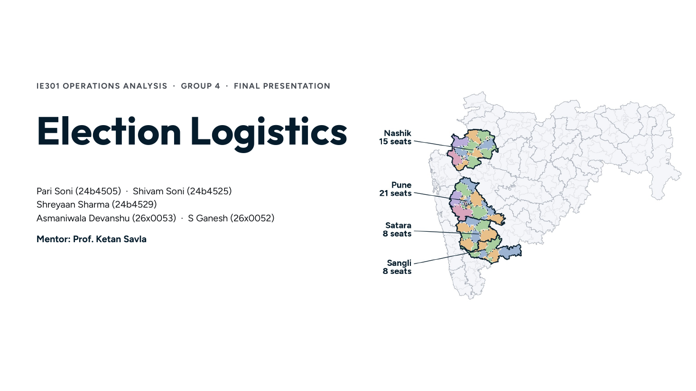

### 2. Problem statement
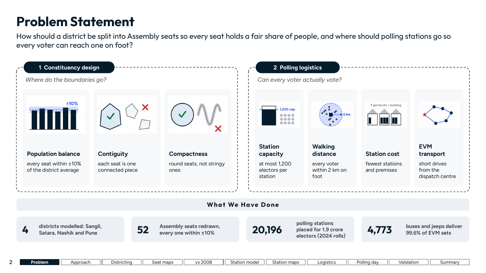

### 3. Our approach
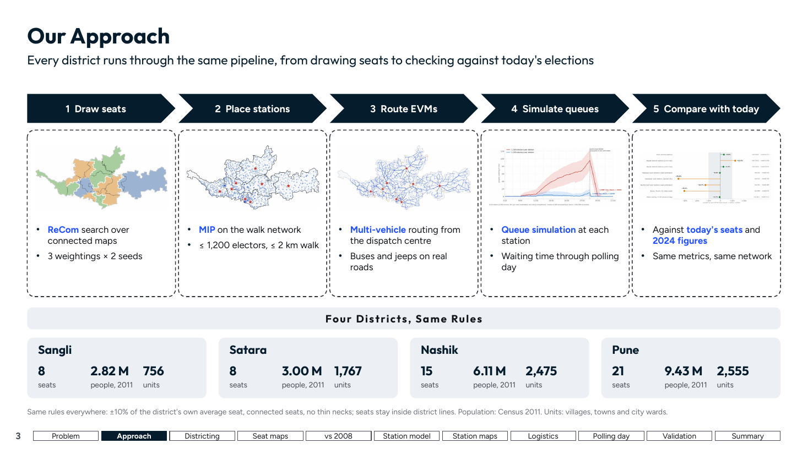

### 4. Districting model: ReCom
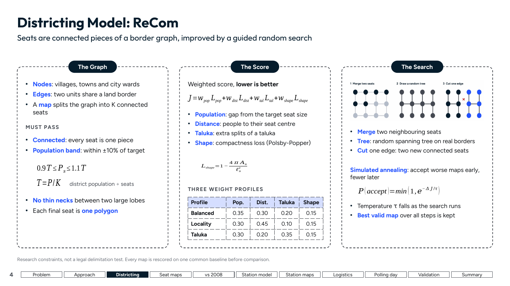

### 5. Districting results by weighting
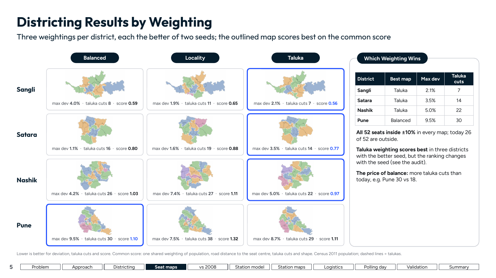

### 6. Comparison with current constituencies
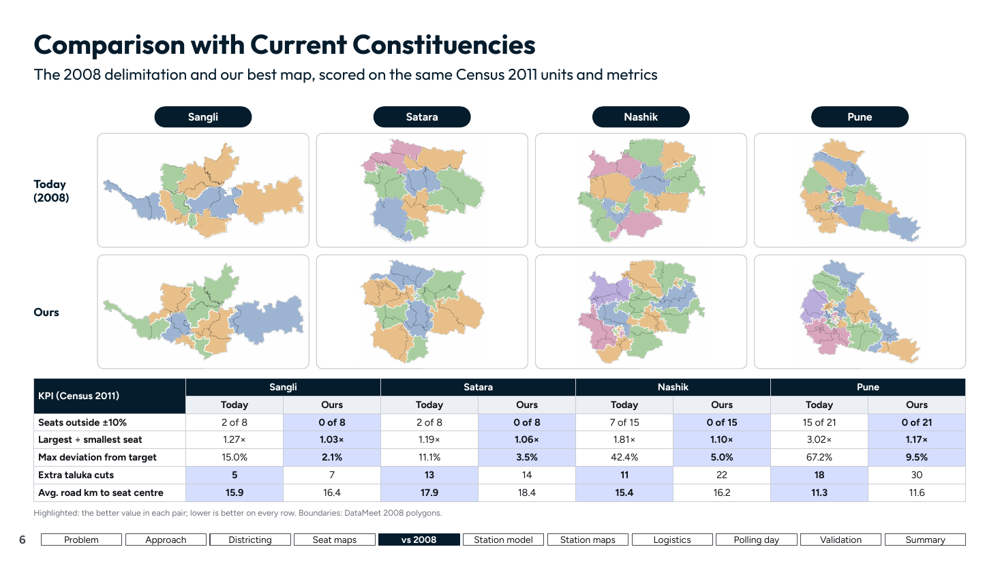

### 7. Polling station location: data pipeline
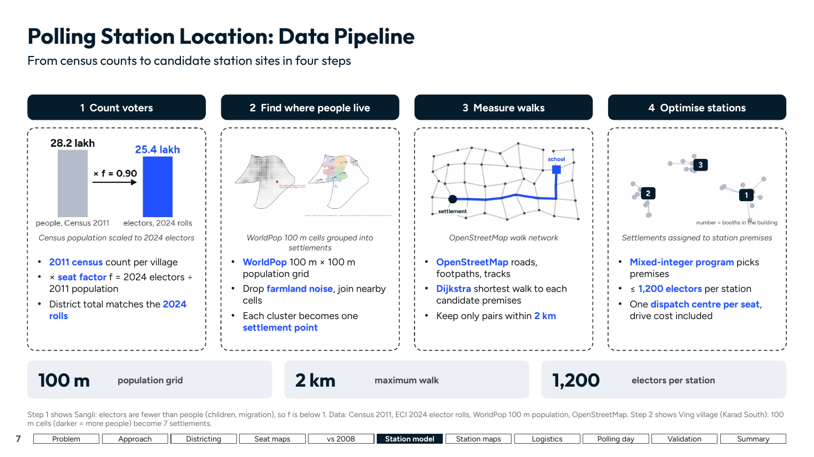

### 8. Polling station location: MIP formulation
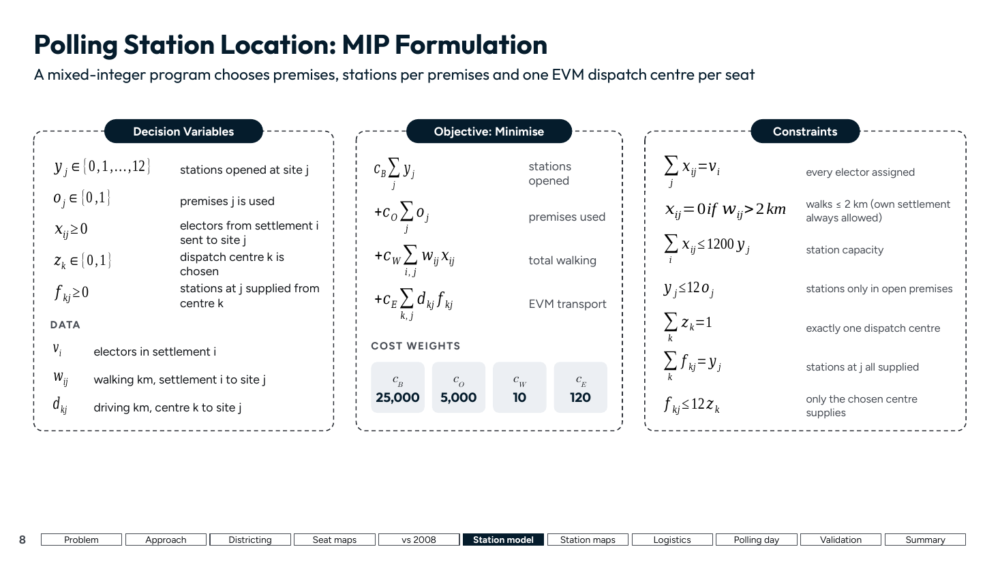

### 9. Polling station location: results
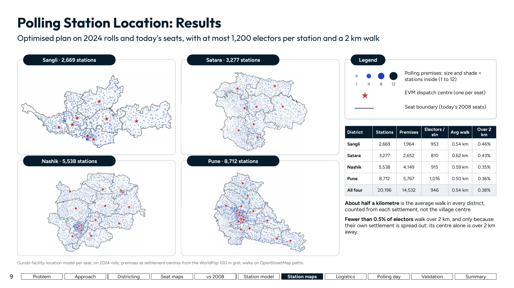

### 10. Election logistics: movement and cost heads
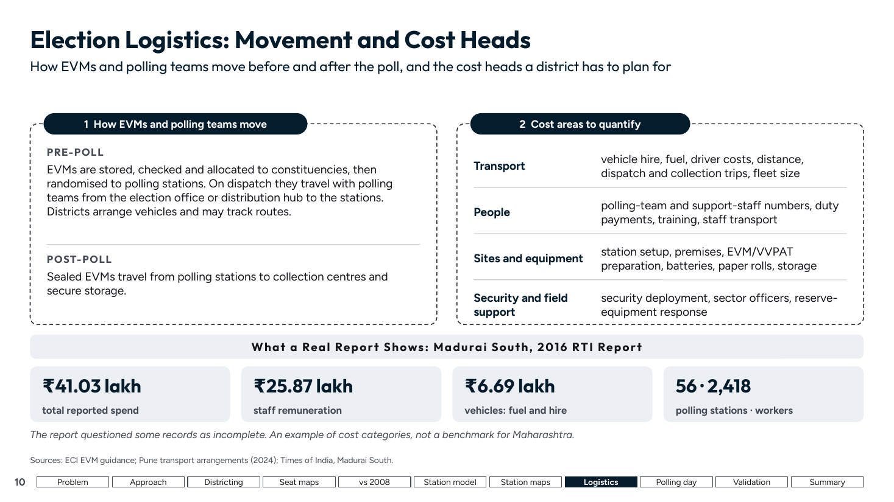

### 11. Our plan vs today's stations and EVM warehouses
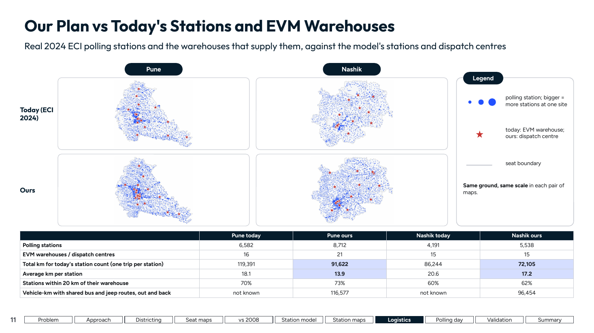

### 12. Logistics cost of our plan
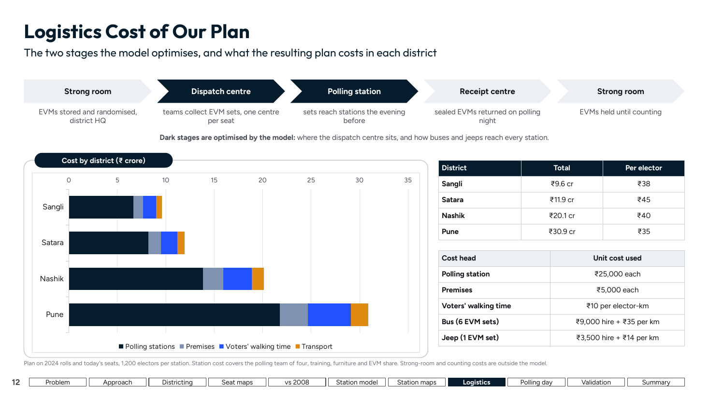

### 13. EVM dispatch routing: model
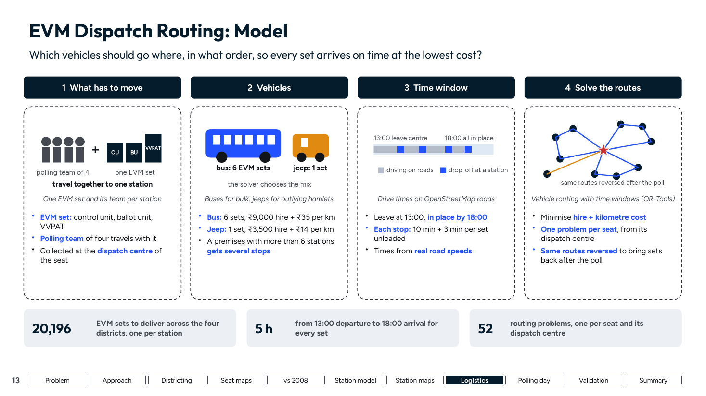

### 14. EVM dispatch routing: results
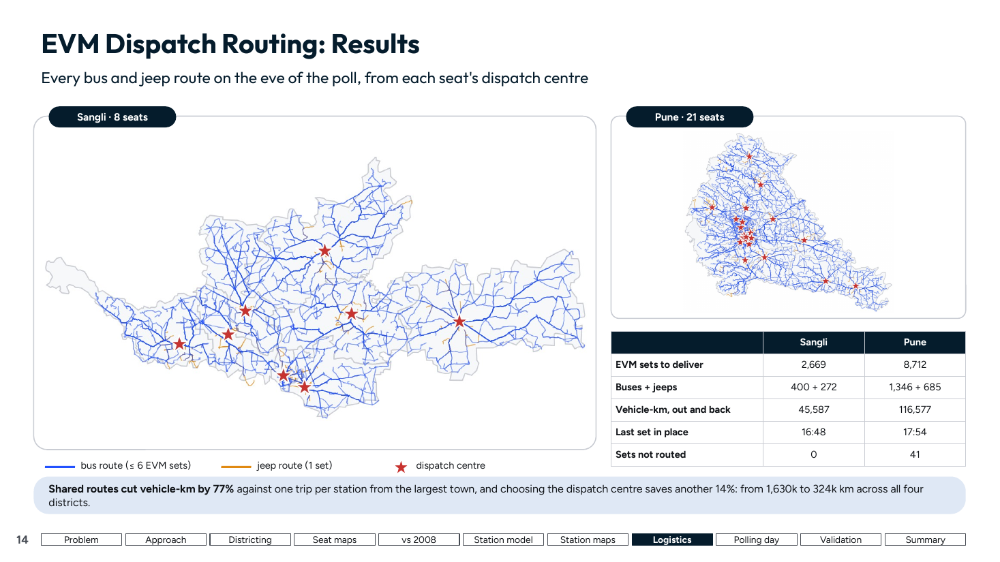

### 15. Polling day simulation: model
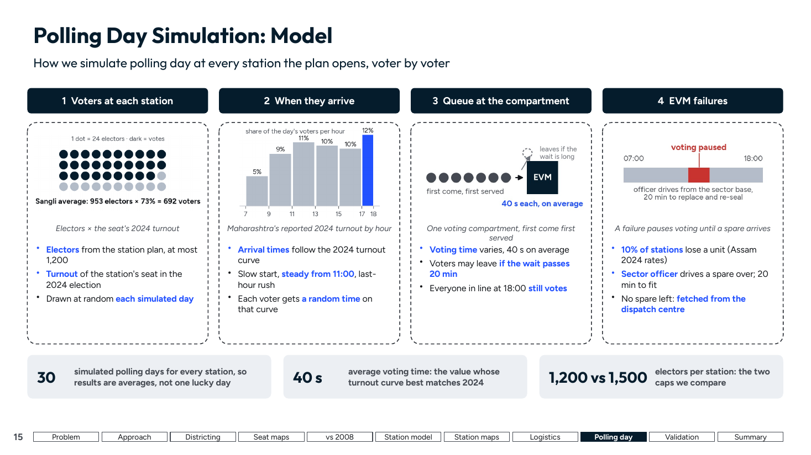

### 16. Polling day simulation: results
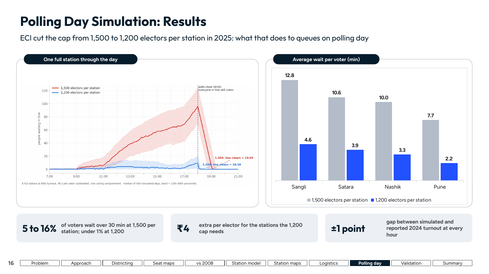

### 17. Validation against the 2024 election
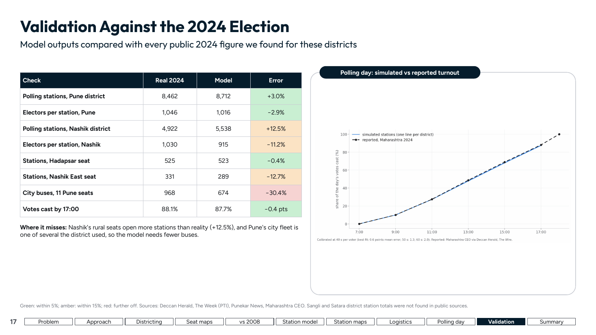

### 18. Summary
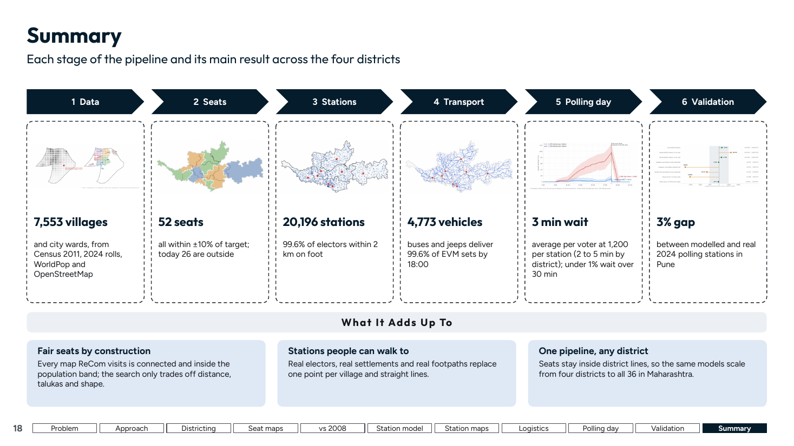
